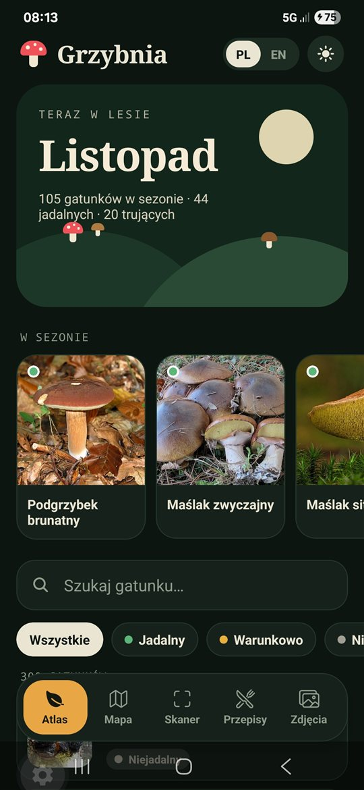
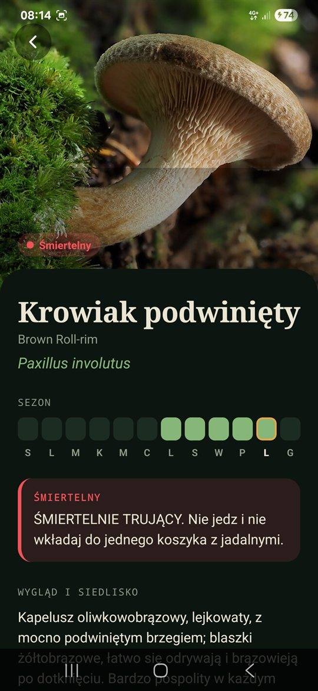
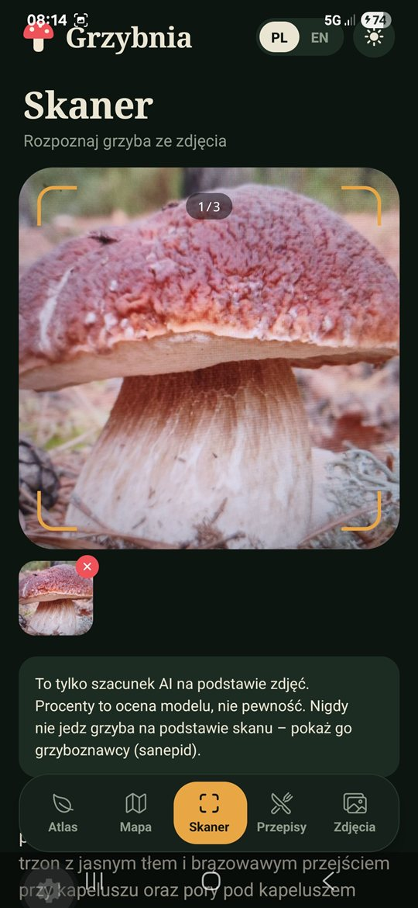
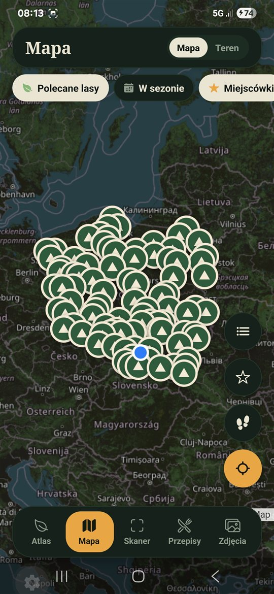
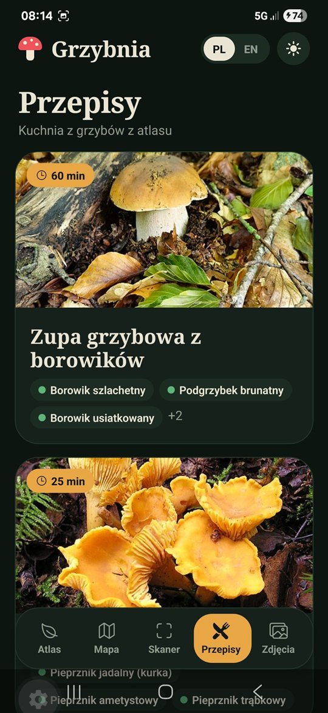

# Grzybnia

Aplikacja mobilna dla grzybiarzy napisana w React Native i Expo. Zawiera atlas 300 gatunków grzybów, skaner
rozpoznający grzyba ze zdjęcia, mapę lasów z własnymi miejscówkami, album zbiorów i przepisy. Działa po polsku
i angielsku, w trybie jasnym i ciemnym. Dane użytkownika zapisują się w telefonie, więc większość funkcji działa
bez internetu.

Platforma: Android (na nią była głównie przygotowywana)
Testowana na fizycznym urządzeniu: tak, telefon z Androidem przez Expo Go
Technologie: Expo SDK 58, React Native 0.88, Expo Router, TypeScript, React Compiler

## Zrzuty ekranu

| Atlas | Karta gatunku | Skaner | Mapa | Przepisy |
|---|---|---|---|---|
|  |  |  |  |  |

Zrzuty z telefonu z Androidem, tryb ciemny.

## Funkcje

### Atlas

300 gatunków podzielonych na jadalne, warunkowo jadalne, niejadalne, trujące i śmiertelnie trujące, z filtrami
i kolorowymi oznaczeniami. Wyszukiwarka szuka po nazwie polskiej, angielskiej i łacińskiej i radzi sobie z wpisem
bez polskich znaków. Na górze ekranu widać gatunki, które rosną w bieżącym miesiącu.

Karta gatunku ma zdjęcie, opis wyglądu i siedliska, kalendarz sezonu, przepisy z tym grzybem oraz opis tego, jak
i dlaczego dany grzyb szkodzi: jakie toksyny zawiera, jakie daje objawy i po jakim czasie. W atlasie jest sporo
groźnych sobowtórów (sromotnik, muchomor jadowity, strzępiaki, hełmówka, lisówka podobna do kurki), żeby można
było porównać je z jadalnymi gatunkami.

### Skaner

Użytkownik dodaje do trzech zdjęć grzyba z aparatu, galerii albo albumu. Aplikacja wysyła je do Claude API
i pokazuje najbardziej prawdopodobne gatunki z atlasu z procentową oceną, groźne sobowtóry razem z tym, jak je
odróżnić, oraz kroki, którymi można się upewnić. Jeśli wśród wyników jest gatunek śmiertelnie trujący, pojawia
się wyraźne ostrzeżenie. Zdjęcia są zmniejszane na telefonie przed wysłaniem.

### Mapa

Mapa OpenStreetMap z wersją terenową. Zaznaczone jest 91 kompleksów leśnych ze wszystkich województw, każdy
z opisem, typowymi grzybami i porą zbioru. Filtr „W sezonie” zostawia tylko lasy, w których akurat trwa sezon.

Dłuższe przytrzymanie palca na mapie dodaje własną miejscówkę z nazwą i notatką. Tryb wycieczki zapamiętuje
punkt startu, rysuje przebytą trasę i pokazuje strzałkę z kompasu wskazującą drogę powrotną, na przykład do
samochodu. Można też włączyć warstwę zakazów wstępu do lasu z Banku Danych o Lasach oraz zgłoszone w okolicy
znaleziska z iNaturalist.

### Album

Zdjęcia z grzybobrań zapisywane razem z datą i miejscem. Do zdjęcia można dodać notatkę, przypisać gatunek
z atlasu, pokazać je na mapie albo wysłać do skanera.

### Przepisy

21 przepisów, między innymi zupa grzybowa, kurki w śmietanie, uszka i opieńki marynowane, plus poradnik
suszenia. Każdy przepis jest powiązany z gatunkami z atlasu.

### Praca bez internetu

Atlas, przepisy i lista lasów są wbudowane w aplikację. Album, miejscówki, trwająca wycieczka i ustawienia
zapisują się lokalnie. Zdjęcia gatunków, które raz się wczytały, są trzymane w pamięci podręcznej, więc później
wyświetlają się też bez zasięgu.

## Skaner

Skaner działa bez klucza i bez pliku `.env`. Zapytania obsługuje serwer wdrożony na EAS Hosting
(`https://grzybnia.expo.app/api/identify`), który trzyma klucz Claude API po swojej stronie. Klucza nie ma
w repozytorium ani w aplikacji.

## Struktura projektu

```
src/
  app/            trasy Expo Router
    index.tsx     główny ekran, zakładki i stan aplikacji
    api/          serwer skanera (identify+api.ts)
  data/           gatunki, przepisy, lasy
  lib/            logika bez interfejsu: zapis danych, zdjęcia, skaner, mapa, obliczenia GPS, miejscówki
  screens/        ekrany aplikacji
  components/     wspólne elementy interfejsu
  styles/         style
  constants/      kolory motywu jasnego i ciemnego
  i18n/           teksty po polsku i angielsku
```

## Decyzje techniczne

Mapa korzysta z Leafleta w `react-native-webview` zamiast `react-native-maps`. Dzięki temu działa w Expo Go
bez klucza Google Maps, ma mapę terenową i pozwala dodać warstwę WMS z zakazami wstępu do lasu.

Lokalizacja i kompas pochodzą z `expo-location`. Zdjęcia obsługują `expo-image-picker`, `expo-image`
i `expo-image-manipulator`.

Animacje (pojawianie się elementów, reakcja przycisków na dotyk, przesuwane podświetlenie zakładek, nagłówek
atlasu, przejścia między ekranami) są zrobione na React Native Animated z natywnym sterownikiem.

Projekt ma włączony React Compiler. Kod przechodzi ESLint z jego regułami, więc kompilator optymalizuje
wszystkie komponenty. Zakładki ładują się dopiero przy pierwszym otwarciu, a listy używają `FlatList`.

## Źródła danych

Opisy gatunków są opracowaniem własnym. Zdjęcia pochodzą z Wikipedii, Wikimedia Commons i iNaturalist.
Mapy: OpenStreetMap i OpenTopoMap. Zakazy wstępu: Bank Danych o Lasach (Lasy Państwowe).
Rozpoznawanie zdjęć: Claude API (Anthropic).

Aplikacja ma charakter edukacyjny. Nie należy jeść grzyba tylko na jej podstawie, zawsze warto pokazać go
grzyboznawcy.
